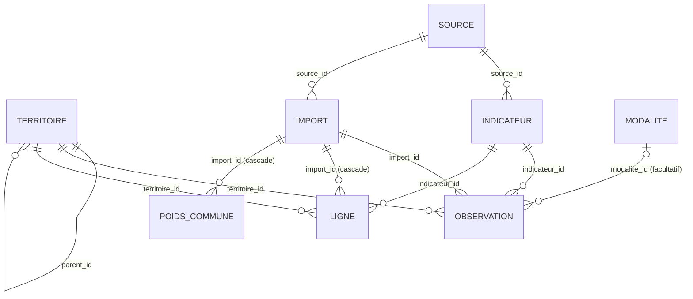

# Schéma de base de données

**Base :** PostgreSQL 17, base `demographie`. **État au :** 21 novembre 2026 (migrations
001 à 025). La source de vérité est `sql/migrations/` ; ce document en donne la vue
d'ensemble.

## 1. Principe

**Une table de faits unique**, `stat.observation`, décrite par quatre référentiels
(territoires, sources, indicateurs, modalités) et tracée par le journal des imports.
Ajouter une donnée = déclarer un indicateur dans une migration et écrire un connecteur :
**le schéma ne change pas**. L'application ne lit que des **vues** du schéma `api`.

## 2. Schémas

| Schéma | Contenu | Écrit par | Lu par |
| --- | --- | --- | --- |
| `ref` | Référentiels : territoires, sources, indicateurs, modalités | migrations (`demo_proprietaire`) | `demo_import` |
| `ingest` | Journal des imports, lignes en transit, poids communaux | `demo_import` | `demo_import` |
| `stat` | Observations publiées, vues dérivées | `demo_import` | `demo_import` |
| `api` | Vues stables pour l'application | migrations | `demo_lecture` (seul accès) |
| `admin` | Suivi des migrations appliquées | `demo migrer` | `demo_proprietaire` |

Rien n'est créé dans `public` (`REVOKE CREATE ON SCHEMA public FROM PUBLIC`).

## 3. Diagramme des relations

## 4. Tables

### `ref.territoire` — environ 121 lignes

| Colonne | Type | Contraintes |
| --- | --- | --- |
| `territoire_id` | smallint | clé primaire, identité |
| `niveau` | text | `FRANCE`, `REG`, `DEP` |
| `code` | text | `^[0-9A-Z]{2,3}$` ; unique avec `niveau` |
| `libelle` | text | non vide |
| `parent_id` | smallint | → `ref.territoire` ; NULL seulement pour `FRANCE/FR` |
| `cog_millesime` | smallint | 2003 à 2100 (aujourd'hui 2026) |

Contenu : `FR` (France), `FM` (France métropolitaine, enfant de FR), 18 régions (enfants de
FR), 101 départements (enfants de leur région), géographie au 1er janvier 2026. Pas de
communes.

### `ref.source` — une dizaine de lignes

| Colonne | Type | Contraintes |
| --- | --- | --- |
| `source_id` | smallint | clé primaire, identité |
| `code` | text | unique, `^[A-Z][A-Z0-9_]+$` |
| `producteur` | text | |
| `libelle` | text | |
| `url` | text | commence par `https://` |
| `licence` | text | défaut « Licence Ouverte 2.0 (Etalab) » |

Codes actuels : `INSEE_COG`, `INSEE_EST`, `INSEE_RP`, `INSEE_EC`, `INSEE_CHOM`, `DREES_PENS`,
`DREES_ASPA`, `MESR_ETU`, `CNAM_PATHO`, `INSEE_FILOSOFI`.

### `ref.rubrique`, `ref.theme`, `ref.unite` — listes de référence (migration 026)

Une application = une rubrique. Une nouvelle application **ajoute ses lignes** dans ces
trois tables, dans sa propre migration ; elle ne réécrit aucune contrainte.

| Table | Colonnes | Lignes actuelles |
| --- | --- | --- |
| `ref.rubrique` | `code` (clé), `libelle`, `chemin` (unique, `/francais`), `ordre` (unique), `theme_obligatoire`, `avec_angles` | `QUI` (`/francais`), `BESOINS` (`/besoins`, thème obligatoire, angles) |
| `ref.theme` | `rubrique` → `ref.rubrique`, `code`, `libelle`, `ordre` ; clé `(rubrique, code)` | `BESOINS` : `BUDGET`, `LOGEMENT`, `ENERGIE`, `EAU`, `ALIMENTATION`, `TRANSPORTS`, `SOINS`, `NUMERIQUE`, `GARDE` |
| `ref.unite` | `code` (clé, minuscules) | `personnes`, `pourcentage`, `pour_mille`, `ratio`, `annees`, `logements`, `nombre`, `euros`, `euros_m2`, `mwh`, `indice`, `consultations_hab`, `pour_10000`, `millions_euros`, `euros_litre` |

Rubriques ajoutées depuis : `SECURITE` (`/securite`, ordre 6, migration 027, thème obligatoire)
et ses familles `PERSONNES`, `VOLS`, `BIENS`, `STUPEFIANTS`, `ROUTES`, `RESSENTI`.

Ordres réservés (unique) : 3 « Comment vivent », 4 « Que votent », 5 « Où va l'argent public »,
6 « Sécurité », 7 « Avenir », 8 « Comment travaillent ». Deux rubriques peuvent avoir un
thème de même code (clé composée). Le thème obligatoire et
les angles sont vérifiés par le déclencheur `indicateur_rubrique` (erreur `check_violation`).

### `ref.indicateur` — le catalogue

| Colonne | Type | Contraintes |
| --- | --- | --- |
| `indicateur_id` | smallint | clé primaire, identité |
| `code` | text | unique, `^[A-Z][A-Z0-9_]+$` |
| `libelle`, `definition` | text | obligatoires |
| `unite` | text | → `ref.unite` (`personnes`, `pourcentage`, `euros`, `euros_m2`…) |
| `nature` | text | `effectif`, `taux`, `flux`, `ratio`, `prix` |
| `source_id` | smallint | → `ref.source` |
| `formule` | text | NULL si publié tel quel ; sinon formule lisible du calcul |
| `avertissement` | text | mise en garde affichée avec le chiffre |
| `comparabilite` | text | règle de comparaison dans le temps et entre territoires |
| `rubrique` | text | → `ref.rubrique` ; défaut `QUI` (appli 1) |
| `theme` | text | → `ref.theme` (clé `rubrique, theme`) ; obligatoire si la rubrique a `theme_obligatoire` (déclencheur) |
| `angle` | text | `ACCES`, `COUT`, `MANQUE` ou NULL ; seulement si la rubrique a `avec_angles` (déclencheur) |
| `borne_min`, `borne_max` | numeric | bornes plausibles (rejet hors bornes) ; `borne_min <= borne_max` |
| `seuil_variation` | numeric | entre 0 et 1 ; NULL = règle générale (3 % pour les effectifs) |

Indicateurs actuels :

| Rubrique | Codes |
| --- | --- |
| QUI — population | `POP`, `PART_MOINS_20`, `PART_60_PLUS`, `PART_75_PLUS`, `INDICE_VIEILLISSEMENT` |
| QUI — état civil | `NAISSANCES`, `DECES`, `SOLDE_NATUREL`, `TAUX_NATALITE`, `TAUX_MORTALITE`, `ICF`, `ESPERANCE_VIE` |
| QUI — emploi | `TAUX_CHOMAGE`, `POP_RP`, `ACTIFS_15_64`, `INACTIFS_15_64`, `RETRAITES_RP`, `TAUX_ACTIVITE_15_64`, `POP_PCS`, `EMPLOIS_RP` |
| QUI — retraites | `PENSIONNES`, `PENSIONNES_DROIT_DIRECT`, `PENSIONNES_POUR_100_ACTIFS`, `MIN_VIEILLESSE`, `TAUX_MIN_VIEILLESSE_60P` |
| QUI — études | `POP_SCOLARISATION`, `TAUX_SCOLARISATION_18_24`, `ETUDIANTS`, `ETUDIANTS_UNIVERSITE` |
| QUI — santé | `PATIENTS_PATHOLOGIE` |
| BESOINS — logement | `LOGEMENTS`, `RESIDENCES_PRINC`, `RESIDENCES_PRINC_CHAUFFAGE`, `PART_PROPRIETAIRES`, `PART_LOCATAIRES_HLM`, `PART_LOGEMENTS_VACANTS`, `PART_CHAUFFAGE_FIOUL`, `NIVEAU_VIE_MEDIAN`, `TAUX_PAUVRETE`, `LOYER_APPARTEMENT_M2`, `LOYER_MAISON_M2`, `PRIX_VENTE_M2`, `ANNEES_REVENU_60M2`, `LOGEMENTS_SOCIAUX` |
| BESOINS — énergie | `CONSO_ELEC_RESID`, `POINTS_ELEC_RESID`, `CONSO_MOY_ELEC_LOGEMENT`, `CONSO_GAZ_RESID`, `POINTS_GAZ_RESID`, `CONSO_MOY_GAZ_LOGEMENT`, `DPE_ETABLIS`, `PART_DPE_FG`, `IPC` |
| BESOINS — budget (France) | `DEPENSE_CONSO_MENAGES`, `PART_DEPENSE_PRE_ENGAGEE` |
| BESOINS — transports et courses | `PRIX_GAZOLE`, `PRIX_SP95_E10` (mensuels, France métropolitaine `FM`), `ACTIFS_TRAJET`, `PART_TRAJET_VOITURE`, `PART_TRAJET_TRANSPORTS_COMMUN`, `MENAGES_VOITURES`, `PART_MENAGES_SANS_VOITURE`, `DEPENSE_CARBURANTS` ; France seulement : `DEPENSE_MOIS_ALIMENTATION`, `DEPENSE_MOIS_TRANSPORTS`, `DEPENSE_MOIS_CARBURANTS` (dépense annuelle / ménages / 12) |
| BESOINS — soins | `APL_MG`, `PART_POP_APL_MG_FAIBLE`, `ALD_SANS_MT`, `LIEUX_MG`, `PHARMACIES`, `URGENCES`, `MAISONS_SANTE`, `MG_10000`, `PHARMACIES_10000` |

### `ref.modalite` — valeurs d'une dimension

| Colonne | Type | Contraintes |
| --- | --- | --- |
| `modalite_id` | smallint | clé primaire, identité ; sert aussi d'ordre d'affichage |
| `dimension` | text | `^[a-z_]+$` |
| `code` | text | unique avec `dimension` |
| `libelle` | text | |

Dimensions actuelles : `statut_activite`, `pcs`, `secteur`, `scolarisation`, `formation`,
`discipline`, `pathologie`, `categorie_logement`, `statut_occupation`, `combustible`,
`taille_appartement`, `type_logement`, `etiquette_dpe`, `poste_ipc`, `poste_conso`.
Les codes reprennent ceux des sources quand c'est possible (traçabilité).

### `ingest.import` — journal, une ligne par fichier

| Colonne | Type | Contraintes |
| --- | --- | --- |
| `import_id` | integer | clé primaire, identité |
| `source_id` | smallint | → `ref.source` |
| `url`, `fichier_nom` | text | |
| `sha256` | char(64) | hexadécimal ; **unique avec `source_id`** : un fichier n'est jamais importé deux fois |
| `taille_octets` | bigint | ≥ 0 |
| `millesime` | text | |
| `statut` | text | `EN_COURS`, `REJETE`, `EN_ATTENTE`, `PUBLIE` |
| `debut`, `fin` | timestamptz | `fin >= debut` |
| `lignes_lues`, `lignes_chargees` | integer | ≥ 0 |
| `message` | text | motif de rejet ou d'attente |

Le fichier lui-même reste sur disque (`DEMO_DONNEES_BRUTES/<sha256>`), inclus dans la
sauvegarde.

### `ingest.ligne` — lignes en transit

Mêmes colonnes que `stat.observation` (sans contraintes de valeurs) plus `a_publier`
(boolean : faux pour une ligne lue seulement pour un contrôle, comme le total France d'un
fichier régional). Supprimées en cascade avec leur import ; conservées tant que l'import est
`EN_ATTENTE`.

### `ingest.poids_commune` — poids pour agréger une source communale

| Colonne | Type | Contraintes |
| --- | --- | --- |
| `dimension` | text | `^[A-Z][A-Z0-9_]+$` (exemple : résidences principales louées) |
| `annee` | smallint | 1990 à 2100 |
| `commune` | text | code commune `^[0-9][0-9AB][0-9]{3}$` |
| `poids` | numeric | ≥ 0 |
| `import_id` | integer | → `ingest.import`, cascade |

Clé primaire (`dimension`, `annee`, `commune`). Jamais publiée.

### `stat.observation` — table de faits

| Colonne | Type | Contraintes |
| --- | --- | --- |
| `indicateur_id` | smallint | → `ref.indicateur` |
| `territoire_id` | smallint | → `ref.territoire` |
| `periode` | date | |
| `periode_type` | text | `1ER_JANVIER`, `ANNEE`, `TRIMESTRE`, `RP`, `MOIS` |
| `sexe` | char(1) | `F`, `H`, `T` (défaut) |
| `age_min`, `age_max` | smallint | 0 à 130, bornes incluses ; `age_max` NULL = « et plus » ; les deux NULL = tous âges |
| `modalite_id` | smallint | → `ref.modalite` ; NULL = total |
| `valeur` | numeric | obligatoire |
| `statut` | text | `PROVISOIRE`, `DEFINITIF` |
| `import_id` | integer | → `ingest.import` (d'où vient la valeur) |

- Unicité `NULLS NOT DISTINCT` sur (`indicateur_id`, `territoire_id`, `periode`, `sexe`,
  `age_min`, `age_max`, `modalite_id`) : deux totaux identiques ne peuvent pas coexister.
- Index (`indicateur_id`, `periode`) pour « tous les territoires à une date » ; index sur
  `import_id`.
- Volume visé : moins d'un million de lignes, moins de 200 Mo.

### `admin.migration`

`nom` (clé primaire), `empreinte` (char(64), SHA-256 du fichier), `appliquee_le`. Une
migration modifiée après application est détectée.

## 5. Vues

| Vue | Type | Rôle |
| --- | --- | --- |
| `stat.structure_age` | matérialisée, index unique (`territoire_id`, `periode`) | Agrégats d'âge de `POP` : population, moins de 20, 60 et plus, 65 et plus, 75 et plus |
| `stat.besoins_derives` | simple | Indicateurs calculés de l'appli 2 (parts d'une modalité dans le total, densités, dépenses par ménage et par mois) ; remplacée à chaque thème |
| `api.territoire` | simple | Territoires avec niveau et code du parent |
| `api.source` | simple | Sources et licences |
| `api.theme` | simple | Rubriques (libellé, chemin, ordre) et leurs thèmes ; lue par l'API pour valider les filtres (migration 026) |
| `api.indicateur` | simple | Catalogue + source + date de dernière publication + rubrique, thème, angle, bornes |
| `api.serie` | simple | **Toutes les séries** « tous âges » : indicateur, niveau, code, année, valeur, provisoire, sexe, période, type de période ; inclut les dérivés (parts d'âge, solde naturel, recensement, pensionnés pour 100 actifs, scolarisation, `stat.besoins_derives`) |
| `api.serie_age` | simple | Valeurs par tranche d'âge (tous sexes, sans modalité) des indicateurs de la rubrique BESOINS : encadré 18-39 ans de la fiche département (migration 023) |
| `api.structure` | simple | Pyramide : effectifs `POP` par sexe et tranche d'âge |
| `api.repartition` | simple | Valeur d'une modalité avec le total de la même série (calcul des parts) |
| `api.etat_import` | simple | Dernier essai et dernière publication par fichier de chaque source |

`stat.rafraichir_vues()` (SECURITY DEFINER, exécutable par `demo_import` seulement)
rafraîchit les vues matérialisées après chaque publication, sans bloquer les lectures.

**Règle :** les parts, taux calculés et ratios ne sont jamais stockés. On stocke les
effectifs publiés et la vue calcule ; un total régional reste ainsi la somme de ses
départements.

## 6. Rôles et droits

| Rôle | Usage | Droits | Garde-fous |
| --- | --- | --- | --- |
| `demo_proprietaire` | Migrations | Propriétaire des schémas | Jamais utilisé par l'application |
| `demo_import` | Imports | Lecture de `ref` ; lecture-écriture de `ingest` et `stat` ; exécution de `stat.rafraichir_vues()` | `statement_timeout = 10min` |
| `demo_lecture` | Web et API | Lecture du schéma `api` uniquement | `default_transaction_read_only = on`, `statement_timeout = 5s` |

Privilèges par défaut : toute nouvelle table de `ingest`/`stat` est accessible à
`demo_import`, toute nouvelle vue de `api` à `demo_lecture`. Rôles créés par
`sql/roles.sql` (idempotent), mots de passe posés par l'installeur.

## 7. Règles de modélisation

1. **Âge en bornes**, jamais en libellés : chaque source a ses tranches.
2. **Période = date + type** : les millésimes manquants (année blanche 2024 du recensement)
   ne posent aucun problème ; ne jamais supposer des années consécutives.
3. **Totaux stockés tels que publiés**, pas recalculés (arrondis des sources).
4. **Pas d'historique des révisions** : une révision remplace la valeur et pointe vers son
   import ; l'ancienne reste dans le fichier brut.
5. **Pas de communes en base** : les sources communales sont agrégées au département dans
   le connecteur.
6. **Une migration par livraison**, numérotée à la suite (prochaine : 026), jamais modifiée
   après fusion. Toute redéfinition de `api.serie` reprend la vue entière et ajoute les
   colonnes en fin.
