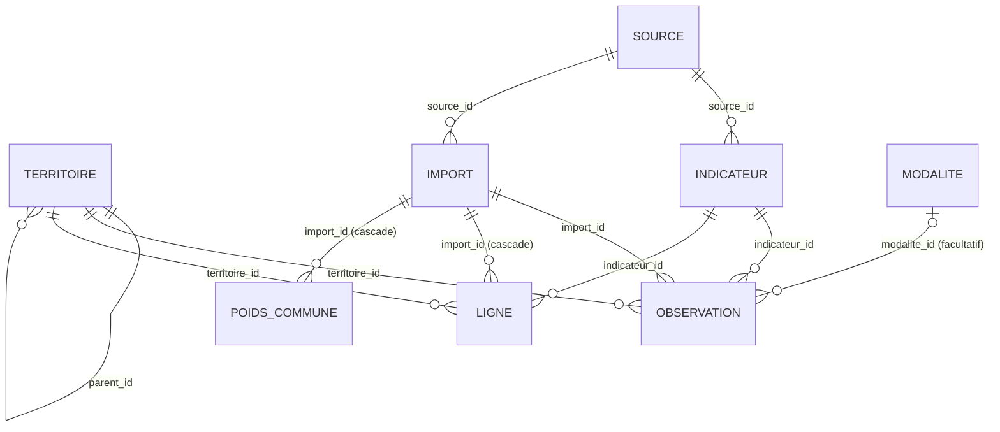

# Schéma de base de données

**Base :** PostgreSQL 17, base `demographie`. **État au :** 21 novembre 2026 (migrations
001 à 025). La source de vérité est `sql/migrations/` ; ce document en donne la vue
d'ensemble.

## 1. Principe

**Une table de faits unique**, `stat.observation`, décrite par quatre référentiels
(territoires, sources, indicateurs, modalités) et tracée par le journal des imports.
Ajouter une donnée = déclarer un indicateur dans une migration et écrire un connecteur :
**le schéma ne change pas**. L'application ne lit que des **vues** du schéma `api`.

## 2. Schémas

| Schéma | Contenu | Écrit par | Lu par |
| --- | --- | --- | --- |
| `ref` | Référentiels : territoires, sources, indicateurs, modalités | migrations (`demo_proprietaire`) | `demo_import` |
| `ingest` | Journal des imports, lignes en transit, poids communaux | `demo_import` | `demo_import` |
| `stat` | Observations publiées, vues dérivées | `demo_import` | `demo_import` |
| `api` | Vues stables pour l'application | migrations | `demo_lecture` (seul accès) |
| `admin` | Suivi des migrations appliquées | `demo migrer` | `demo_proprietaire` |

Rien n'est créé dans `public` (`REVOKE CREATE ON SCHEMA public FROM PUBLIC`).

## 3. Diagramme des relations

## 4. Tables

### `ref.territoire` — environ 123 lignes

| Colonne | Type | Contraintes |
| --- | --- | --- |
| `territoire_id` | smallint | clé primaire, identité |
| `niveau` | text | `FRANCE`, `REG`, `DEP`, `HORS_DEP` (migration 032) |
| `code` | text | `^[0-9A-Z]{2,3}$` ; unique avec `niveau` |
| `libelle` | text | non vide |
| `parent_id` | smallint | → `ref.territoire` ; NULL seulement pour `FRANCE/FR` |
| `cog_millesime` | smallint | 2003 à 2100 (aujourd'hui 2026) |

Contenu : `FR` (France), `FM` (France métropolitaine, enfant de FR), 18 régions (enfants de
FR), 101 départements (enfants de leur région), géographie au 1er janvier 2026. Pas de
communes. Deux territoires `HORS_DEP`, enfants de FR, pour les élections seulement (rubrique
`VOTES`) : `ZZ` Français de l'étranger, `COM` collectivités d'outre-mer (Saint-Pierre-et-
Miquelon, Saint-Barthélemy, Saint-Martin, Wallis-et-Futuna, Polynésie française,
Nouvelle-Calédonie). Pour cette rubrique, France = 101 départements + `ZZ` + `COM`. Ils ne
figurent pas parmi les enfants affichés de la France (`donnees/sql/enfants.sql`).

### `ref.source` — une dizaine de lignes

| Colonne | Type | Contraintes |
| --- | --- | --- |
| `source_id` | smallint | clé primaire, identité |
| `code` | text | unique, `^[A-Z][A-Z0-9_]+$` |
| `producteur` | text | |
| `libelle` | text | |
| `url` | text | commence par `https://` |
| `licence` | text | défaut « Licence Ouverte 2.0 (Etalab) » |

Codes actuels : `INSEE_COG`, `INSEE_EST`, `INSEE_RP`, `INSEE_EC`, `INSEE_CHOM`, `DREES_PENS`,
`DREES_ASPA`, `MESR_ETU`, `CNAM_PATHO`, `INSEE_FILOSOFI`.

### `ref.rubrique`, `ref.theme`, `ref.unite` — listes de référence (migration 026)

Une application = une rubrique. Une nouvelle application **ajoute ses lignes** dans ces
trois tables, dans sa propre migration ; elle ne réécrit aucune contrainte.

| Table | Colonnes | Lignes actuelles |
| --- | --- | --- |
| `ref.rubrique` | `code` (clé), `libelle`, `chemin` (unique, `/francais`), `ordre` (unique), `theme_obligatoire`, `avec_angles` | `QUI` (`/francais`), `BESOINS` (`/besoins`, thème obligatoire, angles) |
| `ref.theme` | `rubrique` → `ref.rubrique`, `code`, `libelle`, `ordre` ; clé `(rubrique, code)` | `BESOINS` : `BUDGET`, `LOGEMENT`, `ENERGIE`, `EAU`, `ALIMENTATION`, `TRANSPORTS`, `SOINS`, `NUMERIQUE`, `GARDE` |
| `ref.unite` | `code` (clé, minuscules) | `personnes`, `pourcentage`, `pour_mille`, `ratio`, `annees`, `logements`, `nombre`, `euros`, `euros_m2`, `mwh`, `indice`, `consultations_hab`, `pour_10000`, `millions_euros`, `euros_litre`, `par_million` (029) |

Rubriques ajoutées depuis : `SECURITE` (`/securite`, ordre 6, migration 027, thème obligatoire)
et ses familles `PERSONNES`, `VOLS`, `BIENS`, `STUPEFIANTS`, `ROUTES`, `RESSENTI` ;
`AVENIR` (`/avenir`, ordre 7, migration 028, thème obligatoire) et ses thèmes `POPULATION`,
`CLIMAT`, `RISQUES`, `EAU`, `AGRICULTURE`, `SANTE`, `EMPLOI` ;
`TRAVAIL` (`/travail`, ordre 8, migration 030, thème obligatoire) et ses thèmes
`CHERCHER_CREER`, `EMPLOI`, `CONDITIONS`, `SALAIRES`, `TELETRAVAIL`, `ACCIDENTS`,
`SYNDICATS_GREVES`. Modalités ajoutées : `secteur` `INTERIM`, `statut_emploi` (`SALARIE`,
`NON_SALARIE`), `type_entreprise` `MICRO` (migration 030) ; `anciennete` `UN_AN_OU_PLUS`,
`famille_metier` (8 familles de l'enquête BMO, codes A, C, I, O, S, T, V, Z) et `metier_bmo`
(217 métiers, code FAP de l'enquête) (migration 034) ; la rubrique affiche aussi
`TAUX_CHOMAGE` (appli 1) et `SALAIRE_NET_MOYEN` (appli « vivre ») par
`ref.indicateur_affichage` (migration 042) ; télétravail et accidents du travail, sources `INSEE_EEC` et `CNAM_RISQUES_PRO` (migration 046) ; `VOTES` (`/votes`, ordre 4, migration 032,
thème obligatoire) et ses thèmes `PARTICIPATION`, `RESULTATS`, `ELUS`. Enfin
`VIVRE` (`/vivre`, ordre 3, migration 031, thème obligatoire) et ses thèmes `REVENUS`,
`POUVOIR_ACHAT`, `INEGALITES`, `EPARGNE`, `PATRIMOINE`, `AIDES_LOGEMENT`, `RETRAITES` ; la
migration 043 y ajoute les sources `INSEE_ERFS` et `INSEE_ENQPAT`, les dimensions de modalités
`decile_niveau_vie` (`D01` à `D10`) et `placement` (`DEPOTS`, `TITRES_CREANCE`, `ACTIONS`,
`FONDS`, `ASSURANCE_VIE`) et sept catégories `pcs` de l'enquête Patrimoine (personne de
référence du ménage, dont quatre de retraités) ; la migration 047, les sources `CNAF` et
`BDF_SUREN`, l'unité `pour_100000` et les dimensions `logement_aide` (`LOCATION`,
`ACCESSION`, `FOYER`) et `type_dette` (`HORS_IMMOBILIER`, `IMMOBILIER`, `CONSOMMATION`,
`CHARGES_COURANTES`) ;
`ARGENT` (`/argent-public`,
ordre 5, migration 033, thème obligatoire) et ses thèmes `DEPENSES`, `RECETTES`, `DETTE`,
`ETAT`, `LOCAL`, `MENAGE`, `CLIMAT`, avec l'unité `milliards_euros` et les dimensions de
modalités `fonction_apu` (dix fonctions COFOG), `etage_apu` (`CENTRALE`, `SECU`, `LOCALE`) et
`nature_recette` (`COTISATIONS`, `PRODUCTION`, `REVENU_PATRIMOINE`, `AUTRES`). Le solde public
est négatif : le contrôle des valeurs négatives admet un indicateur dont `borne_min` est
négative, et celui des pourcentages au-delà de 100 un indicateur dont `borne_max` le permet
(dette en part du PIB). Migration 037 (budget de l'État) : dimensions `impot_etat` (`TVA`,
`IR`, `IS`, `TICPE`, `AUTRES`) et `mission_etat` (33 missions du budget général, code tiré du
libellé ; « Travail et emploi » garde `TRAVAIL_EMPLOI` après son changement de nom), et la vue
`api.repartition_mensuelle` (valeur par modalité d'un indicateur mensuel, avec sa `periode` :
`api.repartition` ne porte que l'année). Migration 044 (collectivités locales) : unité
`millions_euros`, source `DGFIP_COMPTES_LOCAUX`, dimension `poste_local` (`PERSONNEL`,
`AIDES_SOCIALES`, `HEBERGEMENT`, `ACHATS`, `AUTRES_FONCTIONNEMENT`, `EQUIPEMENT`,
`AUTRES_INVESTISSEMENT`) et six indicateurs départementaux du thème `LOCAL` : dépenses et
dette du département (`DEPENSES_DEPARTEMENT`, `DETTE_DEPARTEMENT`), des communes et des
intercommunalités. La Collectivité européenne d'Alsace est rangée sous `67` (rien sous `68`
depuis 2021), la Collectivité de Corse sous `2A` (depuis 2018), Paris n'a plus de budget
départemental depuis 2019 : la page rapporte ces comptes aux habitants des deux départements.

### `ref.indicateur_affichage` — un indicateur dans plusieurs rubriques (migration 031)

Un indicateur est importé une fois, dans sa rubrique d'origine (`ref.indicateur.rubrique`),
et peut s'afficher aussi dans d'autres rubriques, sous un de leurs thèmes, sans être copié.

| Colonne | Type | Contraintes |
| --- | --- | --- |
| `indicateur_id` | smallint | → `ref.indicateur` |
| `rubrique` | text | → `ref.rubrique` ; clé `(indicateur_id, rubrique)` |
| `theme` | text | → `ref.theme` (clé `rubrique, theme`) |
| `ordre` | smallint | ordre d'affichage dans le thème (défaut 0) |

Lignes actuelles (rubrique `VIVRE`) : `NIVEAU_VIE_MEDIAN` (revenus), `TAUX_PAUVRETE`
(inégalités), `IPC` (pouvoir d'achat), `PENSIONNES`, `MIN_VIEILLESSE`,
`TAUX_MIN_VIEILLESSE_60P` (retraites). La vue `api.indicateur_affichage` les expose ; les
lectures `indicateurs` et `fiche` d'une rubrique les ajoutent à ses propres indicateurs,
sous le thème de la rubrique demandée et sans angle de lecture.

Ordres réservés (unique) : 3 « Comment vivent », 4 « Que votent », 5 « Où va l'argent public »,
6 « Sécurité », 7 « Avenir », 8 « Comment travaillent ». Deux rubriques peuvent avoir un
thème de même code (clé composée). Le thème obligatoire et
les angles sont vérifiés par le déclencheur `indicateur_rubrique` (erreur `check_violation`).

### `ref.indicateur` — le catalogue

| Colonne | Type | Contraintes |
| --- | --- | --- |
| `indicateur_id` | smallint | clé primaire, identité |
| `code` | text | unique, `^[A-Z][A-Z0-9_]+$` |
| `libelle`, `definition` | text | obligatoires |
| `unite` | text | → `ref.unite` (`personnes`, `pourcentage`, `euros`, `euros_m2`…) |
| `nature` | text | `effectif`, `taux`, `flux`, `ratio`, `prix` |
| `source_id` | smallint | → `ref.source` |
| `formule` | text | NULL si publié tel quel ; sinon formule lisible du calcul |
| `avertissement` | text | mise en garde affichée avec le chiffre |
| `comparabilite` | text | règle de comparaison dans le temps et entre territoires |
| `rubrique` | text | → `ref.rubrique` ; défaut `QUI` (appli 1) |
| `theme` | text | → `ref.theme` (clé `rubrique, theme`) ; obligatoire si la rubrique a `theme_obligatoire` (déclencheur) |
| `angle` | text | `ACCES`, `COUT`, `MANQUE` ou NULL ; seulement si la rubrique a `avec_angles` (déclencheur) |
| `borne_min`, `borne_max` | numeric | bornes plausibles (rejet hors bornes) ; `borne_min <= borne_max` |
| `seuil_variation` | numeric | de 0 (inclus, migration 036 : toute modification attend une validation, résultats des élections) à 1 ; NULL = règle générale (3 % pour les effectifs) |

Indicateurs actuels :

| Rubrique | Codes |
| --- | --- |
| QUI — population | `POP`, `PART_MOINS_20`, `PART_60_PLUS`, `PART_75_PLUS`, `INDICE_VIEILLISSEMENT` |
| QUI — état civil | `NAISSANCES`, `DECES`, `SOLDE_NATUREL`, `TAUX_NATALITE`, `TAUX_MORTALITE`, `ICF`, `ESPERANCE_VIE` |
| QUI — emploi | `TAUX_CHOMAGE`, `POP_RP`, `ACTIFS_15_64`, `INACTIFS_15_64`, `RETRAITES_RP`, `TAUX_ACTIVITE_15_64`, `POP_PCS`, `EMPLOIS_RP` |
| QUI — retraites | `PENSIONNES`, `PENSIONNES_DROIT_DIRECT`, `PENSIONNES_POUR_100_ACTIFS`, `MIN_VIEILLESSE`, `TAUX_MIN_VIEILLESSE_60P` |
| QUI — études | `POP_SCOLARISATION`, `TAUX_SCOLARISATION_18_24`, `ETUDIANTS`, `ETUDIANTS_UNIVERSITE` |
| QUI — santé | `PATIENTS_PATHOLOGIE` |
| BESOINS — logement | `LOGEMENTS`, `RESIDENCES_PRINC`, `RESIDENCES_PRINC_CHAUFFAGE`, `PART_PROPRIETAIRES`, `PART_LOCATAIRES_HLM`, `PART_LOGEMENTS_VACANTS`, `PART_CHAUFFAGE_FIOUL`, `NIVEAU_VIE_MEDIAN`, `TAUX_PAUVRETE`, `LOYER_APPARTEMENT_M2`, `LOYER_MAISON_M2`, `PRIX_VENTE_M2`, `ANNEES_REVENU_60M2`, `LOGEMENTS_SOCIAUX` |
| BESOINS — énergie | `CONSO_ELEC_RESID`, `POINTS_ELEC_RESID`, `CONSO_MOY_ELEC_LOGEMENT`, `CONSO_GAZ_RESID`, `POINTS_GAZ_RESID`, `CONSO_MOY_GAZ_LOGEMENT`, `DPE_ETABLIS`, `PART_DPE_FG`, `IPC` |
| BESOINS — budget (France) | `DEPENSE_CONSO_MENAGES`, `PART_DEPENSE_PRE_ENGAGEE` |
| BESOINS — transports et courses | `PRIX_GAZOLE`, `PRIX_SP95_E10` (mensuels, France métropolitaine `FM`), `ACTIFS_TRAJET`, `PART_TRAJET_VOITURE`, `PART_TRAJET_TRANSPORTS_COMMUN`, `MENAGES_VOITURES`, `PART_MENAGES_SANS_VOITURE`, `DEPENSE_CARBURANTS` ; France seulement : `DEPENSE_MOIS_ALIMENTATION`, `DEPENSE_MOIS_TRANSPORTS`, `DEPENSE_MOIS_CARBURANTS` (dépense annuelle / ménages / 12) |
| BESOINS — soins | `APL_MG`, `PART_POP_APL_MG_FAIBLE`, `ALD_SANS_MT`, `LIEUX_MG`, `PHARMACIES`, `URGENCES`, `MAISONS_SANTE`, `MG_10000`, `PHARMACIES_10000` |

### `ref.modalite` — valeurs d'une dimension

| Colonne | Type | Contraintes |
| --- | --- | --- |
| `modalite_id` | smallint | clé primaire, identité ; sert aussi d'ordre d'affichage |
| `dimension` | text | `^[a-z_]+$` |
| `code` | text | unique avec `dimension` |
| `libelle` | text | |

Dimensions actuelles : `statut_activite`, `pcs`, `secteur`, `scolarisation`, `formation`,
`discipline`, `pathologie`, `categorie_logement`, `statut_occupation`, `combustible`,
`taille_appartement`, `type_logement`, `etiquette_dpe`, `poste_ipc`, `poste_conso`,
puis `peril_catnat` (migration 040 : `INONDATION`, `SECHERESSE`, `MOUVEMENT_TERRAIN`,
`VAGUES`, `TEMPETE`, `AUTRES`, périls des arrêtés de catastrophe naturelle regroupés).
Les codes reprennent ceux des sources quand c'est possible (traçabilité).

### `ingest.import` — journal, une ligne par fichier

| Colonne | Type | Contraintes |
| --- | --- | --- |
| `import_id` | integer | clé primaire, identité |
| `source_id` | smallint | → `ref.source` |
| `url`, `fichier_nom` | text | |
| `sha256` | char(64) | hexadécimal ; **unique avec `source_id`** : un fichier n'est jamais importé deux fois |
| `taille_octets` | bigint | ≥ 0 |
| `millesime` | text | |
| `statut` | text | `EN_COURS`, `REJETE`, `EN_ATTENTE`, `PUBLIE` |
| `debut`, `fin` | timestamptz | `fin >= debut` |
| `lignes_lues`, `lignes_chargees` | integer | ≥ 0 |
| `message` | text | motif de rejet ou d'attente |

Le fichier lui-même reste sur disque (`DEMO_DONNEES_BRUTES/<sha256>`), inclus dans la
sauvegarde.

### `ingest.ligne` — lignes en transit

Mêmes colonnes que `stat.observation` (sans contraintes de valeurs) plus `a_publier`
(boolean : faux pour une ligne lue seulement pour un contrôle, comme le total France d'un
fichier régional). Supprimées en cascade avec leur import ; conservées tant que l'import est
`EN_ATTENTE`.

### `ingest.poids_commune` — poids pour agréger une source communale

| Colonne | Type | Contraintes |
| --- | --- | --- |
| `dimension` | text | `^[A-Z][A-Z0-9_]+$` (exemple : résidences principales louées) |
| `annee` | smallint | 1990 à 2100 |
| `commune` | text | code commune `^[0-9][0-9AB][0-9]{3}$` |
| `poids` | numeric | ≥ 0 |
| `import_id` | integer | → `ingest.import`, cascade |

Clé primaire (`dimension`, `annee`, `commune`). Jamais publiée.

### `ingest.programme_releve` — veille des programmes présidentiels (migration 045)

Une ligne par adresse suivie et par relevé du lundi (`programmes/<élection>/suivis.toml`).
Les fiches elles-mêmes sont des fichiers du dépôt, pas des tables.

| Colonne | Type | Contrainte |
| --- | --- | --- |
| `releve_id` | integer | identité |
| `election` | text | `^[0-9]{4}$` |
| `candidat`, `version` | text | identifiants des fiches |
| `url` | text | `https://` |
| `releve_le` | timestamptz | défaut `now()` |
| `statut_http`, `taille_octets` | smallint, bigint | résultat du téléchargement |
| `sha256` | char(64) | nul si le téléchargement a échoué |
| `change` | boolean | empreinte différente du relevé précédent de la même adresse |
| `message` | text | erreur éventuelle |

Vue `api.programme_releve` : dernier relevé de chaque adresse et date du dernier changement
(page « Sources »). Rôle import : lecture et ajout seulement, rien n'est effacé.

Vue `api.rubrique` (migration 047) : code, libellé, chemin et ordre de chaque rubrique, pour
que les pages « Programmes » relient un chiffre de contexte à l'appli de « Données » qui le
présente.

### `stat.observation` — table de faits

| Colonne | Type | Contraintes |
| --- | --- | --- |
| `indicateur_id` | smallint | → `ref.indicateur` |
| `territoire_id` | smallint | → `ref.territoire` |
| `periode` | date | |
| `periode_type` | text | `1ER_JANVIER`, `ANNEE`, `TRIMESTRE`, `RP`, `MOIS`, `SCRUTIN` (jour d'un tour d'élection, migration 032) |
| `sexe` | char(1) | `F`, `H`, `T` (défaut) |
| `age_min`, `age_max` | smallint | 0 à 130, bornes incluses ; `age_max` NULL = « et plus » ; les deux NULL = tous âges |
| `modalite_id` | smallint | → `ref.modalite` ; NULL = total |
| `valeur` | numeric | obligatoire |
| `statut` | text | `PROVISOIRE`, `DEFINITIF` |
| `import_id` | integer | → `ingest.import` (d'où vient la valeur) |

- Unicité `NULLS NOT DISTINCT` sur (`indicateur_id`, `territoire_id`, `periode`, `sexe`,
  `age_min`, `age_max`, `modalite_id`) : deux totaux identiques ne peuvent pas coexister.
- Index (`indicateur_id`, `periode`) pour « tous les territoires à une date » ; index sur
  `import_id`.
- Volume visé : moins d'un million de lignes, moins de 200 Mo.

### `stat.projection` — projections (migration 028, appli 5)

Table de faits séparée : une projection a un **scénario** et une **statistique**, qu'une
observation n'a pas, et ne doit jamais se mélanger aux séries observées.

| Colonne | Type | Contraintes |
| --- | --- | --- |
| `indicateur_id`, `territoire_id` | smallint | → `ref.indicateur`, `ref.territoire` |
| `scenario_id` | smallint | → `ref.scenario` |
| `periode`, `periode_fin` | date | `periode_fin` NULL = instant (1er janvier) ; sinon flux annuel ou moyenne sur 30 ans |
| `sexe`, `age_min`, `age_max` | | comme `stat.observation` |
| `statistique` | text | `VALEUR` (défaut), `MEDIANE`, `BAS`, `HAUT` (ensemble de modèles climatiques) |
| `valeur` | numeric | obligatoire |
| `import_id` | integer | → `ingest.import` |

Unicité `NULLS NOT DISTINCT` sur toutes les dimensions. `ref.scenario` : `code`, `libelle`,
`famille` (`INSEE`, `GIEC`, `NIVEAU_RECHAUFFEMENT`, `REFERENCE`), `description`,
`equivalent_giec`, `ordre` ; aujourd'hui `INSEE_CENTRAL`, `INSEE_POP_BASSE`,
`INSEE_POP_HAUTE`, puis (migration 038) `GIEC_SSP126`, `GIEC_SSP245`, `GIEC_SSP585` avec
leur réchauffement mondial vers 2100 dans `equivalent_giec`. Vue `api.projection_climat` :
médiane, bas et haut sur une ligne par indicateur, territoire, scénario et période. Unités
ajoutées : `degres_c`, `jours`, `millimetres`. Lignes en transit dans `ingest.ligne_projection`. Une publication
remplace toutes les valeurs de l'indicateur pour le scénario du fichier.

Les risques naturels (migration 040, thème `RISQUES`) sont des faits observés, rangés dans
`stat.observation` : `CATNAT_ARRETES` (reconnaissances par année d'événement, total et par
péril, les deux dernières années `PROVISOIRE`), `CATNAT_SECHERESSE_10ANS` et
`COMMUNES_PPRN` (parts de communes, en %).

### `ref.scrutin` et `ref.choix_scrutin` — élections (rubrique `VOTES`, migration 032)

Un **scrutin** est un tour d'une élection : une modalité de la dimension `scrutin` (code
`PRES_2022_T1`, libellé « Présidentielle 2022, 1er tour »), décrite dans `ref.scrutin`.

| Colonne de `ref.scrutin` | Type | Contraintes |
| --- | --- | --- |
| `modalite_id` | smallint | clé primaire, → `ref.modalite` |
| `election` | text | `PRESIDENTIELLE`, `LEGISLATIVES`, `EUROPEENNES`, `MUNICIPALES` |
| `annee`, `tour` | smallint | tour 1 ou 2 ; unique avec `election` |
| `jour` | date | unique ; même année que `annee` ; c'est la `periode` des observations |
| `type_choix` | text | `CANDIDAT`, `LISTE`, `NUANCE` ; NULL = participation seulement (municipales) |

20 tours : présidentielles 2002 à 2022 (deux tours), législatives 2022 et 2024 (deux tours),
européennes 2019 et 2024, municipales 2020 et 2026 (deux tours).

Un **choix** est ce que l'électeur a pu choisir à un scrutin (candidat, liste, ou nuance
aux législatives) : une modalité de la dimension `choix`, code préfixé par celui du scrutin
(`PRES_2022_T1_P05`), libellé officiel tel quel. `ref.choix_scrutin` : `modalite_id` (clé),
`scrutin_id` → `ref.scrutin`, `panneau`, `nuance` et `nuance_libelle` (dictionnaire du
ministère), `sexe` du candidat ou de la tête de liste. Pas de colonne « bloc ». Le rôle
d'import ajoute un choix par la seule fonction `ref.ajouter_choix(...)` (SECURITY DEFINER) :
il n'écrit jamais directement dans `ref.modalite`. Dimension `mandat` des élus : `MAIRE`,
`CONSEILLER_DEP`, `DEPUTE`, `SENATEUR`.

Indicateurs (migration 036, source `MI_ELECTIONS`, période = `jour` du tour, type
`SCRUTIN`, statut `DEFINITIF`, seuil de variation 0) : `INSCRITS`, `VOTANTS`,
`ABSTENTIONS`, `BLANCS_ET_NULS`, `EXPRIMES` sans modalité (le jour suffit à reconnaître le
scrutin), `BLANCS` et `NULS` depuis 2014 seulement ; `VOIX` par modalité `choix`. Pour 2002
et 2007, le fichier source ne contient ni les Français de l'étranger ni les collectivités
d'outre-mer : pas de valeur `FRANCE/FR`, seulement `FM` et les départements. Le contrôle
des sommes compte `HORS_DEP` dans la France entière.

Élus (migration 041, source `MI_RNE`, période = premier jour du mois de la mise à jour du
Répertoire, type `MOIS`) : un indicateur d'effectif par mandat, `ELUS_MAIRES`,
`ELUS_CONSEILLERS_DEP`, `ELUS_DEPUTES`, `ELUS_SENATEURS`, au total, par sexe, par tranche
d'âge (18-39, 40-59, 60-74, 75 ans ou plus) et par groupe socioprofessionnel (modalité
`pcs`) ; `AGE_MEDIAN_ELUS` (ratio, années) par modalité `mandat`. Un indicateur par
mandat parce qu'une observation n'a qu'une modalité. Paris, la Corse, la Martinique et la
Guyane n'ont pas de conseillers départementaux. Aucun nom n'est stocké.

### `admin.migration`

`nom` (clé primaire), `empreinte` (char(64), SHA-256 du fichier), `appliquee_le`. Une
migration modifiée après application est détectée.

## 5. Vues

| Vue | Type | Rôle |
| --- | --- | --- |
| `stat.structure_age` | matérialisée, index unique (`territoire_id`, `periode`) | Agrégats d'âge de `POP` : population, moins de 20, 60 et plus, 65 et plus, 75 et plus |
| `stat.besoins_derives` | simple | Indicateurs calculés de l'appli 2 (parts d'une modalité dans le total, densités, dépenses par ménage et par mois) ; remplacée à chaque thème |
| `stat.securite_derives` | simple | Tués sur la route par million d'habitants (population au 1er janvier) ; ajoutée à `api.serie` (migration 029) |
| `stat.vivre_derives` | simple | Foyers au RSA de décembre pour 1 000 habitants (population du 1er janvier suivant), dossiers de surendettement pour 100 000 habitants, aide au logement moyenne par foyer, écart de salaire femmes-hommes ; ajoutée à `api.serie` (migration 047, dernière définition de la vue) |
| `api.territoire` | simple | Territoires avec niveau et code du parent |
| `api.source` | simple | Sources et licences |
| `api.indicateur_affichage` | simple | Indicateurs affichés dans une autre rubrique que la leur, avec thème et ordre (migration 031) |
| `api.theme` | simple | Rubriques (libellé, chemin, ordre) et leurs thèmes ; lue par l'API pour valider les filtres (migration 026) |
| `api.indicateur` | simple | Catalogue + source + date de dernière publication + rubrique, thème, angle, bornes |
| `api.serie` | simple | **Toutes les séries** « tous âges » : indicateur, niveau, code, année, valeur, provisoire, sexe, période, type de période ; inclut les dérivés (parts d'âge, solde naturel, recensement, pensionnés pour 100 actifs, scolarisation, `stat.besoins_derives`, `stat.securite_derives`, `stat.vivre_derives`) |
| `api.serie_age` | simple | Valeurs par tranche d'âge (tous sexes, sans modalité) des indicateurs de la rubrique BESOINS : encadré 18-39 ans de la fiche département (migration 023) |
| `api.structure` | simple | Pyramide : effectifs `POP` par sexe et tranche d'âge |
| `api.repartition` | simple | Valeur d'une modalité avec le total de la même série (calcul des parts) |
| `api.ventilation` | simple | Toutes les observations ventilées (sexe, âge ou modalité), avec leur période exacte : ce que `api.serie` ne montre pas (rubrique travail : secteurs, familles et métiers BMO, chômage par âge ; migration 035) |
| `api.scenario` | simple | Scénarios dans l'ordre d'affichage (migration 028) |
| `api.projection` | simple | Valeurs projetées : indicateur, niveau, code, scénario, année, période, sexe, âges, statistique |
| `api.projection_population` | simple | Par territoire, scénario et année : population, part des moins de 20 ans et des 75 ans ou plus, 65 ans ou plus pour 100 personnes de 20 à 64 ans (calculés depuis `PROJ_POP`) |
| `api.scrutin` | simple | Les 20 tours : code, libellé, élection, année, tour, jour, type de choix (migration 032) |
| `api.choix_scrutin` | simple | Choix de chaque scrutin : code, libellé officiel, panneau, nuance, sexe (migration 032) |
| `api.participation` | simple | Par scrutin et territoire : inscrits, votants, abstentions, blancs, nuls, blancs et nuls, exprimés, taux d'abstention et de participation, part des blancs (et des blancs et nuls) parmi les votants (migration 036) |
| `api.resultat` | simple | Voix de chaque choix par territoire, avec la part des exprimés (pourcentage officiel) (migration 036) |
| `api.elus` | simple | Par mandat, territoire et mois : élus, femmes, moins de 40 ans, âge médian, part de femmes et des moins de 40 ans (migration 041) |
| `api.etat_import` | simple | Dernier essai et dernière publication par fichier de chaque source |

`stat.rafraichir_vues()` (SECURITY DEFINER, exécutable par `demo_import` seulement)
rafraîchit les vues matérialisées après chaque publication, sans bloquer les lectures.

**Règle :** les parts, taux calculés et ratios ne sont jamais stockés. On stocke les
effectifs publiés et la vue calcule ; un total régional reste ainsi la somme de ses
départements.

## 6. Rôles et droits

| Rôle | Usage | Droits | Garde-fous |
| --- | --- | --- | --- |
| `demo_proprietaire` | Migrations | Propriétaire des schémas | Jamais utilisé par l'application |
| `demo_import` | Imports | Lecture de `ref` ; lecture-écriture de `ingest` et `stat` ; exécution de `stat.rafraichir_vues()` | `statement_timeout = 10min` |
| `demo_lecture` | Web et API | Lecture du schéma `api` uniquement | `default_transaction_read_only = on`, `statement_timeout = 5s` |

Privilèges par défaut : toute nouvelle table de `ingest`/`stat` est accessible à
`demo_import`, toute nouvelle vue de `api` à `demo_lecture`. Rôles créés par
`sql/roles.sql` (idempotent), mots de passe posés par l'installeur.

## 7. Règles de modélisation

1. **Âge en bornes**, jamais en libellés : chaque source a ses tranches.
2. **Période = date + type** : les millésimes manquants (année blanche 2024 du recensement)
   ne posent aucun problème ; ne jamais supposer des années consécutives.
3. **Totaux stockés tels que publiés**, pas recalculés (arrondis des sources).
4. **Pas d'historique des révisions** : une révision remplace la valeur et pointe vers son
   import ; l'ancienne reste dans le fichier brut.
5. **Pas de communes en base** : les sources communales sont agrégées au département dans
   le connecteur.
6. **Une migration par livraison**, numérotée à la suite (prochaine : 026), jamais modifiée
   après fusion. Toute redéfinition de `api.serie` reprend la vue entière et ajoute les
   colonnes en fin.
